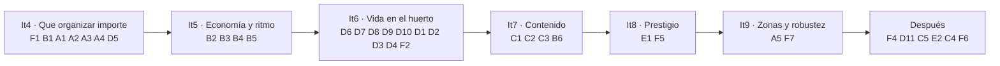

# 🌱 Tiny Harvest — Plan de diseño

> Documento vivo. Lo vamos actualizando en cada iteración.
> **Estado:** borrador v0.15 · **Última actualización:** 2026-10-28
> **Roles:** Claude programa · el autor revisa y guía.

---

## 0. Concepto

- **Nombre provisional:** Huerto Diminuto / *Tiny Harvest*
- **Género:** incremental **activo** de granja con trabajadores automáticos y gestión ligera.
- **Idea:** empiezas recogiendo a mano en una parcela pequeña. Con las monedas contratas **gnomos** que recogen, plantan y transportan por ti. El huerto crece, aparecen cultivos nuevos y los gnomos se especializan. Al final "reinicias" el huerto a cambio de semillas doradas permanentes.
- **Gancho:** a diferencia de muchos incrementales, que son solo números, aquí **ves a cada gnomo trabajar** (como un hormiguero) y **organizas cómo trabajan**. El progreso no viene solo de comprar más, sino de organizarlos mejor.
- **Tono:** gnomos clásicos (gorro rojo, barba, botas) con humor: torpes, orgullosos, quejicas y entrañables.

---

## 1. Lenguaje y tecnología

### 1.1 Programación ✅

**TypeScript + PixiJS + Vite**, con guardado en `localStorage`.

| Opción | Pros | Contras |
|---|---|---|
| **TypeScript + PixiJS** ⭐ | Navegador, se comparte con un enlace, itch.io, cientos de sprites sin problema | Estructura a mano |
| Godot (GDScript) | Editor visual, multiplataforma | Más pesado para la web |
| Unity (C#) | Muy potente | Excesivo para el género |

**Plataformas:** primero solo navegador (escritorio). Para no cerrar la puerta a otras plataformas:
- Lógica del juego separada del render (simulación pura en TS, testeable).
- Interfaz pensada para ratón, pero sin depender del hover (para poder llevarla a táctil).
- Más adelante: **Tauri/Electron** para PC (Steam) y **Capacitor** para móvil, reutilizando el mismo código.

### 1.2 Idioma y tono del juego ✅

- Idioma: **solo español**. Los textos irán juntos en un único fichero para retocarlos fácilmente, sin sistema de traducción.
- Tono: humor blanco y absurdo.
  - Nombres de gnomos: "Pepín Barbatiesa", "Tomasito el Breve", "Don Remolacho"…
  - Descripciones de rasgos con chiste: *"Perezoso: −10 % velocidad. Dice que está 'pensando'."*
  - Mensajes de estado: *"Gilberto se ha sentado en una calabaza. Otra vez."*
  - Mejoras con nombres ridículos: *"Botas con suela de corcho"*, *"Café de bellota"*, *"Seminario motivacional"*.

---

## 2. Vista

- **Cenital 2D en pixel art**: cuadrícula de parcelas vista desde arriba.
- Alternativa descartada por ahora: isométrica (cara de dibujar).

**Distribución de pantalla:**
- **Centro:** el huerto con los gnomos moviéndose (zoom y desplazamiento).
- **Barra superior:** recursos (monedas 🪙, cultivos, semillas doradas ✨).
- **Panel lateral con pestañas:** Contratar · Gnomos · Mejoras · Cultivos · Edificios.
- **Ficha de gnomo:** al hacer clic en un gnomo se ve su nombre, oficio, rasgos, grupo y una frase graciosa.

---

## 3. Estilo visual

- Pixel art **16×16 o 32×32**, colores cálidos y saturados, tono *cozy*.
- **Gnomos:** cuerpo redondito, gorro cónico con el color del oficio, barba, 2–4 frames (andar, recoger, cargar, quejarse).
- **Humor visual:** gnomos que tropiezan, se duermen, discuten entre ellos o se sientan sobre la cosecha. Bocadillos con iconos (💤 😤 ❗).
- **Respuesta visual:** cultivos que saltan, números flotantes (+5 🪙), partículas de hojas.
- **Paleta:** tipo *Resurrect 64* o *Sweetie 16*.

**Assets (de momento) ✅:** sprites dibujados por código o un pack gratuito (p. ej. Kenney, CC0). Para la demo empiezo con sprites por código y cambiamos si encontramos un pack que encaje. El arte propio queda para más adelante.

**Prueba de asset generado descartada:** se mantienen los gnomos originales y sus animaciones por código. La propuesta de GPT Image 2 queda en `estilo/gnomo-prueba.webp` solo como referencia, sin uso en el juego.

**Estilo cerrado ✅** (referencia: [estilo/gnomo.html](estilo/gnomo.html))
- **Gnomos a 16×16**, ampliados ×3–4 en pantalla, con contorno oscuro `#1a1c2c`. El gorro les tapa los ojos, tienen una nariz enorme, barba blanca, túnica verde azulada y botas de 2 px. Andan a saltitos.
- **Color del gorro por oficio:** rojo (recolector), lima (sembrador), marrón (porteador), azul (regador), dorado (capataz), gris (guardián).
- **Animaciones:** quieto, andar (4 fotogramas), recoger (agacharse), cargar saco, protestar (bocadillo "!!") y siesta (Zz).
- **Huerto:** un **bancal rectangular continuo**, con surcos de lado a lado, borde de tierra oscura y hierba que invade los bordes. Crece añadiendo filas o columnas.
- **Plantas:** sprites de 16×14 con contorno, sombreado y dibujo propio por cultivo en las cinco fases: semilla, brote, joven, creciendo y madura. Frutos, espigas, flores y zarcillos más detallados; aviso amarillento antes de estropearse y moho gris al echarse a perder. Ráfagas ocasionales desplazan 1 px las seis filas superiores de las plantas vivas, sin mover el montículo; semillas y plantas echadas a perder no se mecen.
- **Profundidad:** plantas y gnomos se ordenan por fila, así que un gnomo puede quedar delante o detrás de una planta.
- **Terreno y edificios:** hierba de textura suave con matas espaciadas, caminos de borde escalonado y sombras de contacto pixeladas. Luz desde arriba a la izquierda en tejados, paredes, troncos y pedestales; las mejoras conservan sus detalles visibles.
- **Interfaz:** selección de herramientas marcada, semillas bloqueadas legibles y estados del árbol con bordes, símbolos y texto además del color. En pantallas estrechas, la barra se envuelve, el árbol permite desplazamiento horizontal y la ficha de mejora pasa debajo; el lienzo se reajusta cuando cambia el espacio disponible.

---

## 4. Ciclo del juego

**Ciclo corto (segundos):**
> Plantar → crecer → recoger (clic o gnomo) → vender → monedas

**Ciclo medio (minutos), el núcleo activo:**
> Contratar gnomos → **organizarlos** en grupos con prioridades → detectar cuellos de botella → mejorar → desbloquear cultivos y parcelas

**Ciclo largo (temporadas), el prestigio ✅ (iteración 8):**
> «Fin de temporada» en la Estatua del Gnomo Dorado: reinicias el huerto y ganas **semillas doradas** según lo ganado (cada vez cuesta más sacar una). Se gastan en el **árbol dorado** de talentos permanentes.
> La primera temporada dura **~1 h**; las siguientes, menos (48 y 39 min según el bot), así que en 1–2 h de juego se nota el ciclo.

**Sin progreso offline ✅:** con el juego cerrado no se avanza nada. Al volver, la partida continúa justo donde quedó. Si la pestaña pasa a segundo plano, la simulación se pausa (sin recuperar el tiempo perdido) y se reanuda al volver.

---

## 5. Gestión de los gnomos

Lo que distingue el juego. **Gestión básica de grupos y prioridades** ✅, nada de microgestión uno a uno.

| Capa | Mecánica | Cuándo |
|---|---|---|
| 1 | **Oficios:** cada gnomo hace un trabajo fijo | Desde el principio |
| 2 | **Grupos:** repartes a los gnomos en grupos (p. ej. "Los de la zanahoria", "Cuadrilla B") | Fase 2 |
| 3 | **Prioridades por grupo:** cada grupo tiene una regla sencilla (ver abajo) | Fase 2 |
| 4 | **Capataz:** potencia a su grupo | Fase 3 |

**Prioridades iniciales (lista corta):**
- *Lo más cercano primero* (rápido, poco desplazamiento).
- *Lo más valioso primero* (más monedas, más paseo).
- *Solo un cultivo concreto* (p. ej. "solo calabazas").

**Principio de diseño:** los problemas tienen que **verse**. Si el granero se llena, los gnomos esperan con sacos y protestan; si un grupo no tiene sembradores, sus parcelas se quedan vacías. Primero se ve el problema y después se mira el número.

**Ideas para más adelante (fuera del alcance actual):** zonas pintadas en el mapa, ánimo y descanso, sinergias y piques entre gnomos.

---

## 6. Progresión

### 6.1 Oficios

| Oficio | Gorro | Función |
|---|---|---|
| 🧺 Recolector | Rojo | Recoge los cultivos maduros |
| 🌰 Sembrador | Verde | Vuelve a plantar las parcelas vacías |
| 🛒 Porteador | Marrón | Lleva la cosecha al granero |
| 💧 Regador | Azul | Acelera el crecimiento |
| 👑 Capataz | Dorado | Mejora a su grupo (y les grita, con cariño) |
| 🛡️ Guardián | Gris | Espanta cuervos y plagas |

### 6.2 Cultivos (tiempo de crecimiento ↔ valor)

Zanahoria → Trigo → Tomate → Calabaza → Fresa → Melón → exóticos (setas brillantes, flor lunar…)

### 6.3 Fases

1. **Fase 1:** clicar a mano, primeros recolectores.
2. **Fase 2:** sembradores y porteadores, grupos con prioridades y primeros cuellos de botella.
3. **Fase 3:** edificios (molino, mercado, casa de gnomos), capataces y venta automática.
4. **Fase 4:** prestigio, biomas nuevos (pantano, montaña, huerto nocturno) y eventos.

### 6.4 Matemática base

- Coste de contratar: `coste = base × 1.15^n`
- Producción lineal con multiplicadores, más un **multiplicador de organización** (eficiencia de la cadena) para premiar la buena gestión.
- Ajustar los números para que la primera temporada dure 1–2 h.

---

## 7. Ideas para que destaque

- **Coleccionar gnomos:** rasgos aleatorios con chiste y algún gnomo raro (legendario) de vez en cuando.
- **Eventos humorísticos:** cuervos, el "sindicato gnomo" pide más café, un gnomo se cree espantapájaros, lluvia de ranas…
- **Diario del huerto:** registro con las frases graciosas de lo que ha pasado.

---

## 8. 🎯 Demo (primer prototipo)

**Objetivo:** comprobar si mirar a los gnomos trabajar y organizarlos engancha. Muy básica y limitada a propósito.

### Incluye

- **Huerto:** cuadrícula fija de 5×5 parcelas y un granero en un lado.
- **Cultivos:** 2, **zanahoria** (rápida y barata) y **tomate** (lenta y valiosa).
- **Acciones manuales:** clic en una parcela vacía para plantar y clic en un cultivo maduro para recogerlo.
- **Venta:** lo que llega al granero se vende automáticamente.
- **Gnomos:** 2 oficios, **recolector** (recoge y lleva al granero) y **sembrador**. Coste creciente (`× 1.15^n`).
- **Grupos:** hasta 2 grupos, cada uno con una prioridad (*cercano* / *valioso* / *solo X*).
- **Mejoras:** 3–4 sencillas (velocidad al andar, capacidad del saco, crecimiento más rápido).
- **Personalidad mínima:** nombre aleatorio gracioso y un bocadillo de vez en cuando.
- **Visual:** sprites por código, números flotantes y animación simple de andar.
- **Guardado:** `localStorage` al cerrar y cada X segundos, sin progreso offline.

### No incluye (todavía)

Prestigio, edificios, porteador, regador, capataz, guardián, eventos, rasgos con efectos, zoom y cámara, sonido.

### Criterios para darla por buena

- [x] En 5–10 minutos se pasa de clicar a mano a tener un huerto automático. *(El bot lo consigue en 1–5 min.)*
- [x] Cambiar la prioridad de un grupo tiene un efecto **visible** en cómo se mueven los gnomos. *(Desde la iteración 4; falta que lo confirme el autor jugando.)*
- [ ] Es entretenido dejarlo un minuto y solo mirar. *(Desde la iteración 6 pasa algo distinto cada 2–5 s de media según el bot; falta que lo confirme el autor jugando.)*

---

### Estado de la demo (2026-10-27)

Primera versión jugable hecha. Probada en Chrome: los gnomos recogen, entregan en el granero, replantan, y el diario y los grupos funcionan.

**Cómo ejecutarla**
```bash
npm install      # solo la primera vez
npm run dev      # abre la URL que muestra Vite
npm test         # tests de la simulación
npm run build    # genera dist/ para subir a itch.io
```
**Atajos de revisión (solo en `npm run dev`):** `?monedas=500&recolectores=3&sembradores=1&porteadores=1&bancal=4&casa=2` empieza una partida limpia con esos gnomos, monedas, bancal y casa (si no caben los gnomos, la casa se amplía sola).

**Estructura**
- `src/sim/`: simulación pura (estado, reglas, IA de los gnomos, guardado), con tests.
- `src/render/`: sprites por código, fondo y escena PixiJS. Solo leen el estado.
- `src/ui/panel.ts`: barra superior, pestañas, grupos y diario en HTML.
- `src/textos.ts`: todos los textos del juego.

### Opinión tras jugar la demo v1

- **Ritmo:** demasiado rápido; se compra todo enseguida.
- **Grupos:** no se nota la diferencia entre prioridades.
- **Lo mejor:** mirar a los gnomos, comprar mejoras y organizar grupos.
- **Pedido para la siguiente iteración:** marcar los grupos en el huerto, ampliar el bancal con cámara que se adapte, porteador y cultivos nuevos.

### Iteración 2 (hecha)

Atajos de revisión ampliados: `?monedas=400&recolectores=4&sembradores=2&porteadores=1&bancal=5`.

| Cambio | Detalle |
|---|---|
| **Grupos visibles** | Aro de color bajo cada gnomo (A azul, B rosa) y una marca del mismo color en la parcela a la que va. Los colores se repiten en el panel. |
| **Bancal ampliable** | Empieza en 3×3 y llega a 9×6, una columna o una fila cada vez. Coste: `25 × 1,55^n`. |
| **Cámara** | Se ajusta al huerto: muy cerca al principio y se aleja según crece, siempre con escala entera para que el pixel art no se deforme. |
| **Porteador** (gorro marrón) | Con porteadores, los recolectores dejan la cosecha en una **cesta** junto al bancal (máximo 30) y los porteadores la llevan al granero, 5 por viaje. Si la cesta se llena, los recolectores esperan con el saco: un cuello de botella que se ve. |
| **Cultivos** | Zanahoria (2 monedas, 10 s) → Trigo (5, 16 s, se desbloquea por 60) → Tomate (12, 28 s, por 250) → Calabaza (40, 60 s, por 1.200). |
| **Ritmo más lento** | Recolector 12, sembrador 18, porteador 45, ×1,18 por cada gnomo del mismo oficio. Mejoras más caras y con más niveles (hasta 4–5). |

La partida guardada de la v1 no es compatible con esta versión: se empieza de cero.

### Iteración 3: menús dentro del mundo (hecha y probada)

| Cambio | Detalle |
|---|---|
| **Acceso desde el huerto** | Clic en el **granero** → Contratar. Clic en el **tablón de anuncios** → Grupos. Clic en el **árbol viejo** → Árbol de mejoras. Al pasar el ratón por encima, el elemento se resalta con un contorno y aparece su nombre. Abajo hay una barra pixel art con los mismos accesos, el diario y la semilla elegida para plantar a mano. |
| **Ventanas pixel art** | Marco de madera sobre pergamino, encima del huerto, que sigue moviéndose detrás. Se cierran con la X o con Esc. Desaparece el panel lateral. |
| **Árbol de mejoras** | Sustituye a las mejoras sueltas. Crece hacia arriba desde la raíz «Huerto» en tres ramas. **Gnomos:** botas → café / saco → porteadores → cesta grande. **Bancal:** ampliar (9 niveles). **Cultivos:** trigo → abono / tomate → calabaza. Cada nodo necesita a su padre; los porteadores y los cultivos nuevos se desbloquean aquí. |
| **Grupos libres** | Se pueden crear todos los que se quiera (hasta 20) y borrarlos. Cada grupo tiene **nombre editable**, **color** elegido de la paleta del juego (12 colores) y prioridad. Los gnomos se mueven entre grupos arrastrándolos o con «Mover aquí». Los nuevos van al primer grupo. |
| **Prestigio** | El árbol con semillas doradas sigue pendiente para más adelante. |

**Prueba (2026-10-27):** `tsc`, los 21 tests y `npm run build` pasan. En Chrome, con una ventana de 1280×800 y otra de 1024×600, se han comprobado estas cosas:
- Los menús se abren desde el granero (el contorno y el nombre aparecen al pasar el ratón) y desde la barra, y se cierran con Esc.
- Al comprar trigo en el árbol se gastan 60 monedas y se activa la semilla de trigo en la barra.
- Se puede crear un grupo, mover un gnomo con «Mover aquí» y ver aros de dos colores en el huerto.
- Al recoger a mano se suman las monedas.
- Tras recargar se conservan las monedas, los gnomos y los grupos.

**Arreglado en la prueba:** el **diario** crecía más que la pantalla y quedaba tapado por la barra. Ahora las ventanas no pasan de la altura disponible y el contenido se desplaza (`.win-layer` en `style.css`).

### Estudio de equilibrio tras la iteración 3

Un bot jugó 3 horas de partida simulada. Compraba siempre lo más barato y replantaba con el mejor cultivo. Los tiempos son de un jugador muy eficiente; una persona real irá algo más lenta, pero no 2–4 veces más.

| Momento | Activo (1 clic/s) | Tranquilo (1 clic/5 s) |
|---|---|---|
| Huerto automático | 1,0 min | 3,8 min |
| Trigo | 8,4 min | 13,1 min |
| Tomate | 17,8 min | 24,4 min |
| 40 gnomos (tope) | 18,3 min | 25,1 min |
| Árbol completo | **23,2 min** | **31,4 min** |
| Después | ~69 monedas/s y nada que comprar | ~68 monedas/s y nada que comprar |

**Conclusiones**
1. **El contenido dura una cuarta parte de lo previsto.** La temporada debería durar 1–2 h y todo se acaba a los 25–30 min. Contratar es barato (×1,18 por gnomo), así que el tope de 40 se alcanza pronto, y luego las monedas no tienen en qué gastarse.
2. **Cada cultivo es mejor que el anterior en todo.** Da más monedas por parcela y más monedas por viaje:

   | Cultivo | Monedas/s por parcela | Monedas por viaje |
   |---|---|---|
   | Zanahoria | 0,20 | 2 |
   | Trigo | 0,31 | 5 |
   | Tomate | 0,43 | 12 |
   | Calabaza | 0,67 | 40 |

   No hay ninguna elección real: la zanahoria y las prioridades «solo X» dejan de tener sentido.
3. **Las prioridades solo cuentan cuando faltan gnomos.** Prueba en un bancal de 9×6 con los cuatro cultivos mezclados:
   - Con 2 recolectores + 2 sembradores: «cercano» da 0,52 monedas/s y «valioso» 4,21.
   - Con 6 + 4: 2,52 frente a 7,97.

   Cuando sobran gnomos (como en la v1, o con 40 gnomos para 54 parcelas) da igual la prioridad. Eso explica la opinión de que «no se nota».
4. **«Valioso» no tiene en cuenta la distancia.** El cálculo resta `valor × 1000`, así que un gnomo cruza todo el bancal por una calabaza aunque tenga una zanahoria al lado.
5. **El sembrador vuelve a plantar lo mismo que había.** Para pasar el huerto a calabaza hay que hacer clic en cada parcela justo cuando está vacía, compitiendo con tus propios sembradores.
6. **Los porteadores no reservan la cesta.** Si hay un solo cultivo, van todos a por él y los que llegan tarde vuelven sin nada.

Las soluciones están en el backlog (sección 9): A1, A2, A3, A4, B2 y B3–B6.

### Iteración 4: que organizar importe (hecha y probada)

| Cambio | Detalle |
|---|---|
| **Semilla por grupo** (A1) | En el tablón, cada grupo tiene «Siembran»: *Lo mismo que había* (por defecto) o un cultivo desbloqueado. Los sembradores plantan esa semilla en lo vacío y en lo echado a perder. Ya no hace falta cazar parcelas vacías a clics. |
| **Podredumbre** (A2) | Lo maduro aguanta un tiempo y después se echa a perder: zanahoria 20 s, trigo 45 s, tomate 20 s, calabaza 90 s. A mitad del aguante **amarillea** (hojas ocres, trigo más oscuro) y deja de saltar. Echada a perder se vuelve **gris de moho** y le da vueltas una mosca. No da monedas. El sembrador la arranca y replanta (tarda 0,8 s más), y un clic tuyo también. |
| **«Valioso» con paseo** (A3) | Elige el mayor valor por paseo: `valor / (distancia + 30)`. Un tomate al lado gana a una calabaza al fondo del bancal. |
| **Prioridad nueva: «Lo que se va a estropear antes»** | Va a lo maduro con menos margen antes de echarse a perder, contando el paseo. Lo que ya no da tiempo a salvar queda para el final. |
| **Reserva de la cesta** (A4) | Cada porteador que va a la cesta se reserva 5 cultivos; si no queda nada para otro, ese no va. |
| **Ranking «Gnomos del mes»** (D5) | Botón *Ranking* en la barra. Arriba: lo que has recogido tú a mano y los cultivos echados a perder. Primera tarjeta: **el mejor de cada oficio** (los que llevan corona). Después, un podio de 3 en seis categorías: el que más monedas genera (valor cosechado), mejor sembrador, el que más lleva al granero, el más andarín (pasos), el más dormilón y el más quejica. |
| **Coronas** | Una por oficio: el recolector, el sembrador y el porteador con más tareas llevan una corona dorada sobre el gorro. Para quitársela hay que sacarle 3 tareas de ventaja, y el diario lo cuenta («X le quita a Y la corona de mejor recolector…»). Solo dan fama. |
| **Bot de equilibrio** (B1) | `npm run balance` (fichero `balance/ritmo.balance.ts`). Imprime el ritmo con dos perfiles de jugador, la comparación de prioridades con distintas plantillas, el tiempo que tarda en cambiar la semilla y la tabla de cultivos. No entra en `npm test`. |
| **Git** (F1) | Repositorio local con un commit por iteración. |

Las partidas de la iteración 3 siguen valiendo: los campos nuevos tienen valores por defecto al cargar.

**Prueba (2026-10-27):** `tsc`, los 31 tests (10 nuevos) y `npm run build` pasan. En Chrome se ha comprobado lo siguiente:
- Con la semilla del grupo en *Tomate*, a los 80 s todo el bancal era de tomates sin ningún clic.
- Las plantas echadas a perder se ven marrones y con mosca; el diario avisa.
- La corona flota sobre el líder, y al pasar el ratón sale «Lleva la corona».
- El ranking se rellena y se actualiza solo.
- No hay errores en la consola.

**Resultados del bot (`npm run balance`)**

Prioridades: bancal de 9×6 con los cuatro cultivos por columnas, 10 min, sin clics.

| Plantilla | Cercano | Valioso | Se va a estropear |
|---|---|---|---|
| 2 rec + 2 sem | 0,83 /s · 356 perdidos | **4,31 /s** · 278 | 0,95 /s · 378 |
| 6 rec + 4 sem | 3,50 /s · 360 | **7,83 /s** · 366 | 2,78 /s · 331 |
| 12 rec + 8 sem | 6,93 /s · 238 | **10,33 /s** · 267 | 4,10 /s · **168** |
| 24 rec + 12 sem | 12,36 /s · 37 | **12,54 /s** · 36 | 11,58 /s · **0** |

- **Las prioridades ya dan resultados distintos con cualquier plantilla.** «Valioso» es la que más gana, y con gnomos de sobra «Se va a estropear» es la única que no pierde nada. Cada una sirve para algo distinto: ganar más o perder menos.
- **«Se va a estropear» gana menos en un bancal mezclado**, porque salva por igual zanahorias que calabazas. Rinde mejor en un grupo de un solo cultivo de poco aguante (tomate). Es una decisión de diseño a revisar en la iteración 5, junto con las ventajas y costes por cultivo (B2).
- **Cambiar de semilla:** con 6 recolectores y 4 sembradores, el 96 % del bancal pasa de zanahoria a calabaza en 1 minuto, sin clics.
- **El ritmo no cambia**, como era de esperar: árbol completo a los 22,7 min (activo) y 28,7 min (tranquilo), y después ~68–69 monedas/s. El bot contrata de más y no se le estropea nada. Esto es trabajo de la iteración 5.

### Estudio de las preguntas abiertas (tras la iteración 4)

El autor no puede jugar, así que las tres preguntas se han respondido con simulaciones (script desechable con el mismo motor del juego) y con capturas del juego.

**1. ¿Se nota la podredumbre y son justos los aguantes?**

Porcentaje de lo maduro que se echa a perder en 10 min (bancal de 9×6 de un solo cultivo, «cercano», sin porteadores):

| Cultivo | Mejoras | 2 rec + 2 sem | 4 + 3 | 6 + 4 | 9 + 6 | 12 + 8 |
|---|---|---|---|---|---|---|
| Zanahoria | ninguna | 80 % | 74 % | 70 % | 56 % | 46 % |
| Zanahoria | a tope | 46 % | 22 % | 9 % | 0 % | 0 % |
| Trigo | ninguna | 75 % | 61 % | 49 % | 36 % | 28 % |
| Trigo | a tope | 28 % | 7 % | 0 % | 0 % | 0 % |
| Tomate | ninguna | 81 % | 72 % | 59 % | 41 % | 30 % |
| Tomate | a tope | 32 % | 3 % | 1 % | 0 % | 0 % |
| Calabaza | ninguna | 56 % | 34 % | 20 % | 7 % | 0 % |
| Calabaza | a tope | 0 % | 0 % | 0 % | 0 % | 0 % |

- **Los aguantes son justos.** Las pérdidas solo aparecen cuando el bancal crece más que la plantilla o que las mejoras, y se arreglan contratando, mejorando o reorganizando. Con mejoras a tope bastan 4 recolectores para cualquier cultivo. Las mejoras de gnomos se vuelven más valiosas, que es lo que se busca.
- **En la partida del bot no se pierde nada**, porque contrata en cuanto puede. Con contratar más caro (iteración 5) aparecerá la escasez y la podredumbre tendrá papel. No hace falta tocar los aguantes ahora.
- **Lo que fallaba era el aviso.** En una hoja de comparación, el tinte de «a punto de estropearse» casi no se distinguía, y el trigo echado a perder era idéntico al maduro (ya era amarillo). **Arreglado:** sprites propios para cada estado (verde → amarillo → gris de moho), y el aviso empieza a mitad del aguante en vez de al 60 %. Así hay al menos 10 s de aviso (zanahoria y tomate) y hasta 45 s (calabaza).

**2. ¿Debe la corona dar algún premio?**

Corona en 60 min (bancal de 9×6 mezclado, 12 rec + 8 sem + 4 port), con un premio de velocidad para el coronado:

| Premio | Cambios de corona (rec / sem / port) | Gnomos distintos coronados | Ventaja final del 1º (tareas) |
|---|---|---|---|
| Ninguno | **15 / 11 / 5** | 6 / 4 / 4 | 3 / 1 / 10 |
| +10 % | 2 / 1 / 3 | 3 / 2 / 3 | 54 / 106 / 77 |
| +25 % | 1 / 1 / 2 | 2 / 2 / 2 | 128 / 177 / 104 |

- **Sin premio.** Cualquier premio hace que el coronado se escape: con un 10 % ya casi no hay cambios de corona, y la gracia de la dinámica es que la corona cambie de cabeza.
- **Una corona por oficio, no una sola.** Con una sola corona por tareas, los recolectores la tenían el 100 % del tiempo (hacen 801 tareas por hora, frente a 701 los sembradores y 534 los porteadores). Midiéndolo frente a la media de cada oficio, pasaban a tenerla los sembradores el 98 % del tiempo. Con una corona por oficio, todos compiten con los suyos y hay unos 31 cambios por hora.

**3. ¿Cuánto debe durar la temporada antes de que exista el prestigio?**

Minutos hasta completar el árbol según dos palancas (bot activo / tranquilo):

| ×coste por gnomo | Coste del árbol ×1 | ×2 | ×3 |
|---|---|---|---|
| 1,18 (ahora) | 23 / 29 | 41 / 48 | 58 / 67 |
| 1,25 | 23 / 29 | 41 / 49 | 59 / 68 |
| 1,30 | 22 / 27 | 41 / 47 | 58 / 66 |

- **Decisión: sin prestigio, la temporada dura ~1 h (árbol completo en 45–60 min).** Las 1–2 h quedan para cuando exista el prestigio. Alargarla más ahora solo alargaría la espera sin nada nuevo que hacer.
- **El coste del árbol es lo que marca la duración.** El coste por gnomo solo retrasa los 40 gnomos: a 1,30 se llega en 51–59 min, frente a 18–24 min ahora.
- **Punto de partida para la iteración 5: coste por gnomo 1,30 y árbol ×3** (58–66 min). Se aplicará junto con B2–B5, que también cambian la economía, y se ajustará con `npm run balance`.

### Iteración 5: economía y ritmo (hecha y probada)

| Cambio | Detalle |
|---|---|
| **Ventajas y costes por cultivo** (B2) | Zanahoria (vale 5, crece en 10 s, aguanta 20 s), trigo (9, 31 s, 60 s), tomate (18, 85 s, 30 s), calabaza (45, 270 s, 120 s). Contando la espera entre madurar y volver a sembrar, cuanto más rápido el cultivo, más monedas por parcela (0,25 → 0,16 monedas/s); cuanto más lento, más monedas por viaje (5 → 45). Con muchos gnomos conviene la zanahoria; con pocos, la calabaza. |
| **Contratar más caro** (B3) | Cada gnomo del mismo oficio cuesta un 30 % más que el anterior (antes, un 18 %). Los nodos del árbol cuestan el triple. |
| **Casa de gnomos** (B4) | Primer edificio: una casa-seta delante del árbol viejo, donde pasean los gnomos sin trabajo. Empieza con 8 camas y cada ampliación añade 4 (8 niveles, hasta 40). Sin cama libre no se contrata. Encima, un contador `gnomos/camas` (en rojo si está llena). La casa crece a la vista: choza, luego chimenea y ventanas, luego dos pisos con banderín. Se pulsa para abrir el granero, que tiene una fila «Casa de gnomos» con el botón *Ampliar*. |
| **Nodos nuevos** (B5) | *Carretilla con una rueda de más*: el porteador lleva 3 cultivos más por viaje y nivel. *Cestos con paja*: lo maduro aguanta un 25 % más por nivel. *Puesto en el mercado*: todo se vende un 15 % más caro por nivel. |
| **Bot de equilibrio** | Elige cultivo según sus gnomos (cada 30 s, lo que más rinde con su plantilla) y amplía la casa. Añade hitos nuevos, el hueco más largo sin compras y la pérdida por minuto, y una sección e) con el mejor cultivo según la plantilla. |

Las partidas anteriores siguen valiendo; si tienen más gnomos que camas, la casa se amplía sola al cargar.

**Prueba (2026-10-27):** `tsc`, los 34 tests (3 nuevos) y `npm run build` pasan. En Chrome se ha comprobado lo siguiente:
- La casa se ve con su contador y se resalta al pasar el ratón; al pulsarla se abre el granero.
- Al ampliarla cambia el dibujo y el contador.
- Con la casa llena, el contador sale en rojo y no se puede contratar.
- El árbol muestra los tres nodos nuevos y su «Ahora: …».
- No hay errores en la consola.

**Resultados del bot (`npm run balance`)**

| Medida | Activo (1 clic/s) | Tranquilo (1 clic/5 s) | Antes (it. 4) |
|---|---|---|---|
| Árbol completo | **59 min** | **65 min** | 23 / 29 min |
| Casa al máximo / 40 gnomos | 51 / 52 min | 56 / 58 min | — / 18–24 min |
| Hueco más largo sin nada que comprar | 4,2 min (al final) | 4,4 min | — |
| Monedas/s en el min 30 / 60 | 20 / 51 | 17 / 43 | — |

El mejor cultivo según la plantilla (bancal 9×6 de un solo cultivo, mejoras a medias, monedas/s):

| Plantilla | Zanahoria | Trigo | Tomate | Calabaza |
|---|---|---|---|---|
| 2 rec + 2 sem | 2,55 | 4,46 | 6,66 | **7,72** |
| 4 + 3 | 4,83 | 8,05 | **11,19** | 8,10 |
| 8 + 5 | 9,03 | **13,74** | 12,60 | 8,18 |
| 12 + 8 | 12,57 | **14,84** | 13,02 | 8,25 |
| 20 + 12 | **17,40** | 15,63 | 12,99 | 8,10 |
| 28 + 12 | **17,48** | 15,53 | 13,11 | 8,18 |

- **Cada cultivo es el mejor para alguna plantilla**: calabaza con muy pocos gnomos, tomate con pocos, trigo con plantilla media y zanahoria con muchos. Elegir semilla por grupo ya es una decisión de verdad.
- **La duración se cumple:** árbol completo en 59 min (activo) y 65 min (tranquilo). El último nodo se queda un poco por encima de los 60 min del objetivo para el jugador tranquilo; se acepta.
- **La podredumbre aparece con plantillas justas** (zanahoria con 8 + 5: 26 % perdido; tomate con 4 + 3: 6,5 %) y no aparece con plantillas holgadas. El bot de ritmo no pierde nada porque contrata todo lo que puede. Como siempre tiene muchos gnomos, siembra zanahoria toda la partida.
- **Pendiente:** al acabar el árbol (min 59–65) vuelve la meseta sin nada que comprar. Es lo que resolverá el prestigio (iteración 8).

### Iteración 6: vida en el huerto (hecha y probada)

| Cambio | Detalle |
|---|---|
| **Rasgos** (D2) | Cada gnomo tiene uno, con un efecto pequeño. *Perezoso*: anda más lento y se para a «pensar». *Nervioso*: más rápido, pero tropieza. *Glotón*: a veces se come una zanahoria recién cogida. *Cotilla*: se para a charlar con quien se cruza. *Dormilón*: más siestas. *Currante*: trabaja más rápido y casi no se sienta. |
| **Legendarios** (D3) | Un 3 % de los contratados, con título («el Magnífico»…), gorro dorado con una banda del color de su oficio, destellos, y anda y trabaja un 25 % mejor. |
| **Bocadillos de intención** (D6) | 14 iconos: el cultivo al que va, saco, cesta, zz, «…» al pensar, corazón, enfado, saludo, charla, cartas, aplauso, ñam y nota musical. Duran 0,9 s para que con muchos gnomos no se llene el bancal. |
| **Reacciones** (D7) | Al cruzarse se saludan (corazoncitos), el cotilla se para a charlar, a veces uno tropieza y cae de culo (polvo y estrellitas). Si te quitan la parcela, enfado. El que gana una corona lo celebra y los de su oficio aplauden o refunfuñan. |
| **Más vida en la cosecha** (D8) | El cultivo vuela en arco de la planta a la mano. El saco de la espalda tiene 3 tamaños, el porteador empuja una carretilla si la has comprado, y la puerta del granero se abre al entregar y crece un montón de cajas al lado. |
| **Ociosos con gracia** (D9) | Se sientan (al lado de una calabaza madura si hay), juegan a las cartas por parejas o persiguen mariposas. |
| **Sucesos** (D4) | Cada 30–90 s pasa algo pequeño. *Cuervo*: se posa en una parcela madura y se la come si nadie va a espantarlo; si hay un gnomo libre, va con los brazos en alto. *Caracol*: cruza el bancal. *Topo*: asoma en una parcela vacía y no deja sembrar mientras está. De vez en cuando, algo raro: lluvia de ranas, huelga del sindicato gnomo (dura menos con café) o un gnomo que se cree espantapájaros. Todo sale en el diario. |
| **Ficha y cámara** (D1) | Al hacer clic en un gnomo (también desde el tablón o el ranking), sale una ficha en la esquina con su oficio, grupo, rasgo, lo que hace ahora («Jugando a las cartas con Pepín»), sus números, una frase del día y «Mover a…». La cámara se acerca y lo sigue, con una flecha encima. Esc o × la cierra. |
| **Cada mejora se ve** (D12) | Cada mejora del árbol deja una pieza en el huerto. *Botas*: zapatero junto a la casa. *Café*: mesita con cafetera humeante. *Saco*: sacos en el granero. *Porteadores*: estandarte del gremio. *Cesta*: aros, asas y borde dorado. *Carretilla*: aparcada (de madera, luego pintada). *Bancal*: valla al máximo. *Cultivos*: cartel que gana una tabla por cultivo. *Abono*: montón de compost y tierra más oscura. *Conservas*: estante de tarros. *Mercado*: toldo, cajas, cartel y bandera. El árbol viejo crece con el total de mejoras (flores, faroles, casita de pájaros) y el tablón se llena de notas con los grupos (tejadillo a partir de 6). |
| **Medir la vida** (D10) | `npm run balance` tiene una sección f) con momentos por minuto, hueco medio y máximo, el tipo más repetido y cuántos tipos distintos. |
| **Migrar partidas** (F2) | Partida versión 4, con una lista de migraciones: las de la versión 3 se cargan y reparten rasgos. |

**Prueba (2026-10-27):** `tsc`, los 41 tests (7 nuevos) y `npm run build` pasan. En Chrome, a 1280×800 y 1024×600, se ha comprobado lo siguiente:
- Bocadillos, saludos, cartas, mariposas, topo, cuervos y espantapájaros.
- El arco de la cosecha y la puerta del granero.
- Las piezas de cada mejora.
- La ficha desde el huerto, el tablón y el ranking, y la cámara siguiendo al gnomo y volviendo.
- No hay errores en la consola.

**Resultados del bot (`npm run balance`, f): vida en el huerto, 10 min**

| Plantilla | Momentos/min | Hueco medio | Hueco máximo | El más repetido | Tipos distintos |
|---|---|---|---|---|---|
| 2 rec + 2 sem (principio) | 12,2 | 5,0 s | 20,8 s | siesta 31 % | 13 |
| 6 + 4 | 25,7 | 2,4 s | 9,3 s | saludo 23 % | 16 |
| 20 + 14 + 6 port | 133,6 | 0,5 s | 2,6 s | siesta 22 % | 17 |

- **Se cumple el objetivo** (hueco medio ≤ 15 s y máximo ≤ 30 s incluso al principio, nada pasa del 40 %).
- **Con 40 gnomos hay unos 2 momentos por segundo** (unos 3 por gnomo y minuto). Por eso los bocadillos se han acortado. Si al jugar resulta agobiante, se baja `LIFE.greet` y la probabilidad de siesta en `config.ts`.
- **El ritmo apenas cambia:** árbol completo en 60,5 min (activo) y 67,9 min (tranquilo), frente a 59 y 65 antes. Los rasgos y las huelgas añaden 1,5–3 min.
- **Pendiente visto en la prueba:** la ficha tapa el borde derecho del bancal a 1280×800 (el gnomo seguido sigue centrado). La barra de abajo tapa las esquinas inferiores de la valla con el bancal al máximo. *(Resuelto en la iteración 7, D13.)*

### Iteración 7: contenido (hecha y probada)

| Cambio | Detalle |
|---|---|
| **Regador** (C1) | Gorro azul y regadera. Llena la regadera en el **pozo** (6 riegos) y riega parcelas que están creciendo. Una parcela regada se ve más oscura y crece un 40 % más rápido durante 90 s. El **tomate y el melón tienen sed**: secos crecen al 30 % y se les ven grietas en la tierra. Se desbloquea con *Regadores* (cuelga de abono). La *Regadera* (3 niveles) hace que el riego dure más y sea más rápido. |
| **Guardián** (C3) | Gorro gris con bastón y farol. Patrulla alrededor del bancal y a ratos vigila al pie de su **atalaya**. Cuando ve un cuervo o un topo (ojo en el bocadillo), va a espantarlo. Así los demás no dejan su trabajo y los topos no bloquean parcelas. Se desbloquea con *Guardianes* (cuelga de botas). El *Silbato* (3 niveles) hace que vea más lejos y ande más rápido. |
| **Fresa y melón** (C2) | *Fresa*: vale 8, crece en 24 s y aguanta solo 10 s madura; rinde con muchos recolectores. *Melón*: vale 60, crece en 300 s, aguanta 60 s y tiene sed; es el mejor con pocos recolectores y regadores. |
| **Multiplicador de organización** (B6) | Lo que se vende se multiplica por hasta ×1,30 según cómo va la cadena en los últimos 2 minutos. Cuenta cuatro cosas: *cosecha a tiempo*, *cesta sin atascos*, *tierra sembrada* y *riego de los sedientos*. La peor de las cuatro pesa la mitad, así que un cuello de botella se nota. En la barra de arriba sale «×1,18» con un desplegable de barras y una pista sobre lo que peor va. |
| **Más sitio para mirar** (D13) | La ficha es más estrecha y se puede plegar a nombre + «Ahora». La cámara encuadra el huerto en el hueco que dejan la ficha y la barra de abajo, así que la valla del bancal al máximo ya no queda tapada. El aviso del diario pasa arriba. |
| **Cada mejora se ve** | El pozo gana tejado, cubo, flores y hiedra con la regadera; la atalaya gana bandera, campana y banderines con el silbato; el cartel del bancal tiene tablas para fresa y melón. |
| **Partida** | Versión 5, con migración desde la 4. |

**Prueba (2026-10-27):** `tsc`, los 46 tests (5 nuevos) y `npm run build` pasan. En Chrome a 1280×800 se ha visto lo siguiente, sin errores en la consola:
- Regadores llenando en el pozo y regando, con el bocadillo de la gota.
- Tierra regada más oscura y grietas en el melón seco.
- El guardián patrullando y en la atalaya.
- Fresas que se pudren enseguida si nadie las recoge.
- La valla entera por encima de la barra.
- El multiplicador con su desplegable: con el bancal lleno de melón y solo 2 regadores, el riego sale en rojo y la pista dice «hacen falta regadores».

**Resultados del bot (`npm run balance`)**

El mejor cultivo según la plantilla (monedas/s, bancal 9×6 de un solo cultivo):

| Plantilla | Zanahoria | Trigo | Fresa | Tomate | Calabaza | Melón |
|---|---|---|---|---|---|---|
| 2 rec + 2 sem | 2,9 | 5,2 | 3,5 | 2,0 | **9,9** | 0,0 |
| 4 + 3 + 2 regadores | 5,5 | 10,2 | 7,2 | 16,2 | 15,8 | **20,9** |
| 8 + 5 | 10,9 | **17,0** | 14,3 | 4,2 | 10,5 | 0,0 |
| 12 + 8 + 4 regadores | 15,0 | 21,3 | 20,3 | **22,3** | 17,4 | 21,0 |
| 20 + 12 | 21,1 | 20,4 | **21,2** | 4,4 | 10,6 | 0,0 |
| 26 + 12 | **22,1** | 20,2 | 21,3 | 4,4 | 10,5 | 0,0 |

- **Los seis cultivos son el mejor en alguna plantilla.** Tomate y melón solo con regadores: sin agua apenas rinden.
- **Regador:** con 12 + 8 y el bancal mezclado, 2 regadores suben de 14,0 a 20,1 monedas/s.
- **Guardián:** con un cuervo cada 10 s y un topo cada 15 s, otros gnomos dejan su trabajo para espantar 10–38 veces sin guardián y 1–14 con él. Los topos bloquean parcelas 480 s sin guardián y 94–191 s con él. Cuando no hay nadie libre salva la cosecha (2 cultivos comidos sin él, 0 con él).
- **Organización:** bien llevado ×1,29; regular (melón y tomate sin regadores) ×1,11; mal llevado (atasco en la cesta, o sin sembradores) ×1,07–1,08. La primera versión, con la media sola, no bajaba de ×1,14; por eso la peor parte pesa ahora la mitad.
- **Ritmo:** árbol completo en 64 min (activo) y 70 min (tranquilo). El hueco más largo sin nada que comprar sube a 7 min, entre el melón y el último nodo.
- **Vida en el huerto:** los objetivos de la iteración 6 se siguen cumpliendo (hueco medio de 5,5 s al principio, máximo 21,9 s).

### Iteración 8: prestigio (hecha y probada)

| Cambio | Detalle |
|---|---|
| **Estatua del Gnomo Dorado** (E1) | Está a la derecha del bancal y crece con las temporadas: pedestal, placa, laurel y halo. **Brilla y suelta chispas cuando ya se puede terminar la temporada.** Se pulsa (o el botón *Estatua* de la barra) para abrir la ventana *Temporada*. |
| **Fin de temporada** | Muestra la temporada, el tiempo jugado, lo ganado y las semillas que darías ahora (`floor((ganado / 850) ^ 0,5)`; hacen falta 6, hacia el minuto 31). Dice qué se queda y qué se pierde, y se confirma con dos pulsaciones. Después sale un resumen (semillas, quién entra en el salón de la fama, qué veteranos vuelven) y caen confeti y hojas doradas sobre el huerto. |
| **Árbol dorado** | 10 talentos permanentes. *Abono dorado*: crece más rápido. *Mercado dorado*: se vende más caro. *Herencia*: empiezas con monedas. *Gnomos con experiencia*: empiezas con un recolector y un sembrador gratis por nivel. *Contrato fijo*: contratar encarece menos. *Bancal heredado* y *Casa heredada*: empiezan ampliados. *Semillas conocidas*: cultivos ya desbloqueados. *Veteranos*: los coronados vuelven con su nombre y rasgo. *Suerte*: más legendarios. Cada talento deja su huella en el huerto: motas doradas en la tierra, cofre de monedas, contrato en la puerta del granero, medalla en el pecho de los veteranos, tréboles… |
| **Salón de la fama** | Por temporada, los coronados (el mejor de cada oficio) con sus tareas, más lo ganado, la duración y las semillas. Arriba, los veteranos y cuántas temporadas llevan. Se llega desde la estatua, desde el resumen y desde el ranking. |
| **Barra de arriba** | Semillas doradas y «Temporada N» a partir de la segunda temporada. |
| **Tutorial** (F5) | Seis pistas, una cada vez, en un bocadillo que señala el botón: plantar y recoger, contratar, el árbol, el tablón, la ficha de un gnomo y, al final, la estatua. Avanzan al hacer la cosa, se pueden saltar o apagar, y se guardan aparte de la partida. Sustituyen a la pista de inicio. |
| **Partida** | Versión 6, con migración desde la 5. Lo permanente (semillas, talentos, salón, veteranos) se guarda y se valida al cargar. |

**Prueba (2026-10-27):** `tsc`, los 52 tests (6 nuevos) y `npm run build` pasan. En Chrome, por el camino real de la interfaz, se ha comprobado lo siguiente sin errores en la consola:
- Una temporada terminada desde la estatua: 90 000 monedas → 10 semillas, resumen y confeti.
- Talentos comprados en el árbol dorado.
- Una segunda temporada terminada: empieza con 200 monedas, 4 gnomos gratis y trigo desbloqueado, y vuelve el veterano con su nombre.
- El salón de la fama con la temporada y el veterano.
- El tutorial en un perfil nuevo; según UiPrestigio, también a 1024×600.

**Resultados del bot (`npm run balance`, sección i): tres temporadas seguidas, jugador activo**

| Temporada | Árbol completo | Se puede terminar desde | Semillas | Talentos al empezar |
|---|---|---|---|---|
| 1 | 64 min | min 31 | 12 | — |
| 2 | **48 min** | min 24 | 12 | abono dorado 2, semillas conocidas 1, bancal heredado 1, herencia 2, mercado dorado 1 |
| 3 | **39 min** | min 19 | 12 | lo anterior + experiencia, contrato, suerte… |

- **Se cumplen los objetivos:** primera temporada de ~1 h con 10–15 semillas, y cada temporada siguiente más corta.
- **Rendimientos decrecientes:** terminar la primera en el min 30 da 5 semillas, en el 45 da 8, en el 65 da 12 y en el 90 da 16. Exprimir de más compensa poco y empezar de nuevo, sí.
- **La meseta del final desaparece:** el tramo sin nada que comprar (7 min antes del último nodo) coincide con el momento en que ya conviene terminar la temporada.

### Iteración 9: zonas y robustez (hecha y probada)

| Cambio | Detalle |
|---|---|
| **Zonas por grupo** (A5) | En el tablón, cada grupo tiene un bancal en miniatura: se pulsan dos parcelas (dos esquinas) y el grupo queda limitado a ese rectángulo; «Todo el bancal» lo quita. Recolectores, sembradores y regadores del grupo solo eligen parcelas de su zona; porteadores y guardianes siguen yendo a todas partes. En el huerto, cada zona lleva un borde punteado del color del grupo (un poco más adentro en cada grupo para que las zonas vecinas no se pisen). Al cambiar la zona, los que iban hacia fuera vuelven a decidir. El diario lo cuenta. Las zonas se pueden solapar. |
| **Partida ilegible a salvo** | Si la partida guardada está dañada o es de una versión desconocida, se aparta una copia (`tiny-harvest:partida:rota:<hora>`) antes de empezar un huerto nuevo, y un aviso deja descargarla. Si no hay sitio ni para la copia, no se guarda nada encima hasta que el jugador la descargue o acepte sustituirla. |
| **Aviso de «sin guardar»** | Si el navegador no deja guardar (modo privado, sin sitio), sale un aviso fijo que se quita solo cuando un guardado vuelve a funcionar. |
| **Parada segura ante errores** | Un error a mitad de fotograma detiene el huerto, no guarda encima de la última copia buena y ofrece recargar. Si el juego no arranca, también se avisa en la página. |
| **Bot de equilibrio** | Nueva sección j) *Zonas*. |

Las partidas anteriores siguen valiendo: los grupos sin zona trabajan en todo el bancal (no hace falta subir la versión de la partida).

**Prueba (2026-10-28):** `tsc`, los 62 tests (10 nuevos: zonas y guardado) y `npm run build` pasan. En Chrome a 1280×800, sin errores en la consola:
- Dos grupos con zonas izquierda y derecha marcadas desde el tablón; bordes punteados azul y rosa en el bancal.
- Partida dañada inyectada antes de cargar: aviso, copia apartada y autoguardado del huerto nuevo sin tocar la copia.
- Error provocado en la simulación: el huerto se para, aparece «Recargar» y la partida guardada no cambia.
- Guardado bloqueado: aparece el aviso de «sin guardar».

**Rendimiento con el juego lleno** (40 gnomos, bancal al máximo, servidor de desarrollo sin minificar, Chromium sin pantalla): unos 1,6 ms de CPU por fotograma con el huerto solo, ~3,5 ms con el ranking abierto y ~1,7 ms con el tablón abierto, a 60 fps (el presupuesto es 16,7 ms). No hace falta optimizar; las mejoras posibles (no redibujar cada fotograma la tierra y las marcas, el ranking a menos ritmo) quedan anotadas por si un equipo lento lo pide.

**Resultados del bot (`npm run balance`, sección j)**: bancal al máximo, 4 columnas de calabaza a la izquierda y zanahoria el resto, 10 min.

| Plantilla | Organización | Monedas/s | Echados a perder | Pasos por gnomo |
|---|---|---|---|---|
| 6 rec + 4 sem | un grupo, «cercano» | 4,89 | 343 | 9.639 |
| 6 rec + 4 sem | un grupo, «valioso» | 5,04 | 326 | 9.748 |
| 6 rec + 4 sem | dos zonas (¼ calabaza, ¾ zanahoria) | 3,58 | 350 | 8.088 |
| 12 rec + 8 sem | un grupo, «cercano» | 7,72 | 236 | 10.175 |
| 12 rec + 8 sem | un grupo, «valioso» | 7,74 | 234 | 10.204 |
| 12 rec + 8 sem | dos zonas (¼ calabaza, ¾ zanahoria) | 5,89 | 272 | 8.800 |

- **Las zonas ahorran paseo (un 14–17 % menos de pasos), pero no dan más monedas.** Partir la plantilla quita flexibilidad: con un solo grupo, los que no tienen calabazas que recoger ayudan con las zanahorias. En pruebas aparte (fresa con zanahoria; melón o tomate con los regadores en su zona; calabaza con solo ⅙ de la plantilla) pasó lo mismo: un grupo «valioso» gana entre un 3 % y un 43 % más.
- **Para qué sirven ahora:** para controlar el huerto. Con la semilla por grupo, sin zonas un grupo acaba plantando su semilla en todo el bancal; con zonas, se puede mantener un bancal mezclado (calabaza a un lado, zanahoria al otro) sin clics.
- **Pendiente de decidir** (pregunta abierta): si las zonas deben dar alguna ventaja propia para que organizar por zonas también compense en monedas.

---

## 9. 🗺️ Backlog y hoja de ruta

> Guía de trabajo. Cada iteración tiene un objetivo y unos criterios para darla por buena. Al terminar una iteración se marcan sus tareas y se anotan los resultados en la sección 8.
> **Tamaño:** S = poco trabajo, M = medio, L = grande.

### 9.1 Backlog

**A. Que organizar los gnomos importe (el núcleo del juego)**

| # | Tarea | Tamaño | Impacto | Depende de | Estado |
|---|---|---|---|---|---|
| A1 | **Semilla por grupo:** cada grupo elige qué siembran sus sembradores | S–M | Alto | — | ✅ It4 |
| A2 | **Podredumbre:** lo maduro se estropea si nadie lo recoge a tiempo, y se ve (planta mustia) | M | Alto | — | ✅ It4 |
| A3 | **«Valioso» que tenga en cuenta la distancia**, no solo el valor | S | Medio | — | ✅ It4 |
| A4 | **Reserva de la cesta** para que no vayan todos los porteadores a por un solo cultivo | S | Bajo | — | ✅ It4 |
| A5 | **Zonas:** asignar a un grupo un rectángulo del bancal | M–L | Alto | A1 | ✅ It9 |

**B. Economía y ritmo**

| # | Tarea | Tamaño | Impacto | Depende de | Estado |
|---|---|---|---|---|---|
| B1 | **Bot de equilibrio** (`npm run balance`): mide el ritmo en cada iteración | S | Alto (herramienta) | — | ✅ It4 |
| B2 | **Ventajas y costes por cultivo:** rápido y laborioso frente a lento y cómodo | S | Alto | A2 | ✅ It5 |
| B3 | **Contratar más caro** (×1,30 por gnomo y árbol ×3, ajustado con el bot) | S | Medio | B1 | ✅ It5 |
| B4 | **Casa de gnomos:** el tope de gnomos depende de este edificio (el primer edificio del juego) | M | Alto | — | ✅ It5 |
| B5 | **Más nodos en el árbol** (carretilla, cestos con paja, puesto en el mercado) | M | Medio | B1 | ✅ It5 |
| B6 | **Multiplicador de organización:** premiar una cadena de trabajo eficiente (hasta ×1,30) | M | Medio | A1, A2 | ✅ It7 |

**C. Contenido**

| # | Tarea | Tamaño | Impacto | Depende de | Estado |
|---|---|---|---|---|---|
| C1 | **Regador** (gorro azul), pozo y riego; tomate y melón con sed | M | Medio | — | ✅ It7 |
| C2 | **Fresa y melón** | S–M | Medio | B2 | ✅ It7 |
| C3 | **Guardián** (gorro gris) contra cuervos y topos, con atalaya | M | Medio | — | ✅ It7 |
| C4 | **Calabaza que ocupa 2×2 parcelas** | L | Bajo | — | Más adelante |
| C5 | **Molino y mercado** | M–L | Medio | B4 | Más adelante |

**D. Personalidad**

| # | Tarea | Tamaño | Impacto | Depende de | Estado |
|---|---|---|---|---|---|
| D1 | **Ficha de gnomo al hacer clic, y la cámara lo sigue** | S–M | Medio | — | ✅ It6 |
| D2 | **Rasgos con efectos que se ven** (perezoso, nervioso, glotón, cotilla, dormilón, currante) | M | Alto | D1 | ✅ It6 |
| D3 | **Gnomos legendarios** | S | Medio | D2 | ✅ It6 |
| D4 | **Pequeños sucesos cada 30–90 s** (cuervo, caracol, topo) y alguno raro (lluvia de ranas, sindicato gnomo, espantapájaros) | M | Medio | — | ✅ It6 |
| D5 | **Ranking de gnomos:** el más trabajador, el que más monedas aporta, el más andarín, el más dormilón… con corona para el líder en el huerto | S–M | Medio | — | ✅ It4 (pedido del autor) |
| D6 | **Bocadillos de intención** | S | Alto | — | ✅ It6 |
| D7 | **Reacciones entre gnomos** (saludos, charlas, tropiezos, enfados, celebrar coronas) | S–M | Alto | — | ✅ It6 |
| D8 | **Más vida en la cosecha** (arco del cultivo, saco que engorda, carretilla, puerta del granero, montón de cajas) | S | Medio | — | ✅ It6 |
| D9 | **Ociosos con gracia** (sentarse, cartas, mariposas) | S | Medio | — | ✅ It6 |
| D10 | **Medir la vida** (sección f de `npm run balance`) | S | Medio (herramienta) | D6–D9 | ✅ It6 |
| D11 | **Día y noche, y tiempo** (atardecer, luciérnagas, farolillos; la lluvia acelera el crecimiento) | M–L | Medio | — | Más adelante |
| D12 | **Los edificios cambian con cada mejora:** cada nodo del árbol deja huella en el huerto; el árbol viejo crece con el total de mejoras y el tablón se llena con los grupos | M | Alto | — | ✅ It6 (pedido del autor) |
| D13 | **Más sitio para mirar:** ficha plegable y cámara que encuadra el hueco libre | S | Bajo | D1 | ✅ It7 |

**E. Largo plazo**

| # | Tarea | Tamaño | Impacto | Depende de | Estado |
|---|---|---|---|---|---|
| E1 | **Prestigio con semillas doradas** (estatua, árbol dorado, salón de la fama, veteranos) | L | Muy alto | B (economía estable) | ✅ It8 |
| E2 | **Biomas** (pantano, montaña, huerto nocturno) | L | Alto | E1 | Más adelante |

**F. Técnica y pulido**

| # | Tarea | Tamaño | Impacto | Depende de | Estado |
|---|---|---|---|---|---|
| F1 | **Repositorio git** | S | Alto (seguridad) | — | ✅ It4 |
| F2 | **Migrar partidas guardadas** (lista de migraciones desde la versión 3) | S | Medio | — | ✅ It6 |
| F3 | **Plantas más detalladas y balanceo suave** | M | Medio | — | Hecho (2026-10-28) |
| F4 | **Sonido** | M | Medio | — | Más adelante |
| F5 | **Pequeño tutorial** al empezar (seis pistas que avanzan al hacer la cosa) | S–M | Medio | — | ✅ It8 |
| F6 | **Táctil y móvil** | M | Bajo por ahora | — | Más adelante |
| F7 | **Robustez:** copia de partidas ilegibles, aviso de «sin guardar», parada segura ante errores | S | Alto (seguridad) | — | ✅ It9 |

### 9.2 Hoja de ruta (opción A: mecánica antes que números)



| Iteración | Objetivo | Se da por buena cuando… |
|---|---|---|
| **4 · Que organizar importe** | Cumplir el criterio de la demo que falta: cambiar la prioridad de un grupo se nota | Con gnomos de sobra, «cercano» y «valioso» dan resultados claramente distintos; se puede pasar el huerto entero a calabaza sin cazar parcelas vacías a clics; el ranking muestra quién destaca |
| **5 · Economía y ritmo** | Que la temporada dure lo previsto (~1 h hasta que exista el prestigio) | Árbol completo en unos 45–60 min (medido con `npm run balance`); siempre hay algo útil que comprar; la zanahoria sigue sirviendo; con plantillas justas aparece algo de podredumbre |
| **6 · Vida en el huerto** | Que sea entretenido dejarlo un minuto y solo mirar | Algo distinto pasa en pantalla cada 10–20 s (medido con `npm run balance`); los bocadillos dicen qué va a hacer cada gnomo; al hacer clic en un gnomo la cámara lo sigue y sale su ficha; los rasgos se notan sin abrir menús |
| **7 · Contenido** | Un oficio nuevo, una amenaza y más cultivos | Regador y guardián con un papel claro; fresa y melón tienen sus propias ventajas y costes |
| **8 · Prestigio** | Que la partida tenga un final y vuelva a empezar | Reiniciar tras 1–2 h da semillas doradas que se notan en la siguiente temporada |
| **9 · Zonas y robustez** | Organizar también por sitio, y no perder partidas | Un grupo con zona no sale de ella; las zonas se ven en el huerto; una partida dañada no se pierde nunca sin avisar |

**Por qué este orden:**
- **Mecánica antes que números.** Ajustar el ritmo antes de tener podredumbre y ventajas por cultivo obliga a ajustarlo dos veces.
- **El bot va en la iteración 4** para que cada cambio de equilibrio se mida, no se adivine.
- **La personalidad apenas toca la economía**, así que se puede adelantar si apetece algo más vistoso.
- **El prestigio va al final** porque multiplica una economía que antes tiene que estar equilibrada.

---

## ❓ Preguntas abiertas

- [ ] Cuando el autor pueda jugar: ¿es entretenido dejarlo un minuto y solo mirar? (último criterio de la demo)
- [ ] ¿Deben las zonas dar alguna ventaja propia? Según el bot (sección j), ahorran un 14–17 % de pasos pero rinden menos que un solo grupo «valioso». Una opción: un pequeño extra de trabajo para los gnomos que trabajan dentro de su zona («se conocen el terreno»).
- [ ] ¿Qué viene después de la iteración 9? Orden propuesto: sonido (F4), día y noche (D11), molino y mercado (C5), biomas (E2), calabaza 2×2 (C4) y táctil y móvil (F6). Antes conviene publicar la demo en itch.io y que alguien la juegue.

---

## ✅ Decisiones tomadas

| # | Tema | Decisión |
|---|---|---|
| 1 | Programación | TypeScript + PixiJS + Vite |
| 2 | Idioma y tono | Solo español, humor absurdo, textos en un único fichero |
| 3 | Plataforma | Primero navegador; arquitectura preparada para PC y móvil |
| 4 | Ritmo | Incremental activo: mejoras, contratación y organización de los gnomos |
| 5 | Desarrollo | Claude implementa; el autor revisa y guía |
| 6 | Personajes | Gnomos clásicos con toque humorístico |
| 7 | Offline | Sin progreso con el juego cerrado; pausa en segundo plano |
| 8 | Gestión | Básica: grupos con prioridades, sin microgestión individual |
| 9 | Temporada | La primera dura 1–2 h |
| 10 | Arte | Sprites por código o pack gratuito, de momento |
| 11 | Primer hito | Demo muy básica (sección 8) para validar la idea |
| 12 | Resolución | Gnomos 16×16 con contorno oscuro |
| 13 | Huerto | Bancal rectangular continuo con surcos |
| 14 | Plantas | Sprites detallados de 16×14 por cultivo y fase, con balanceo suave sin cambiar la simulación |
| 15 | Hoja de ruta | Opción A: mecánica antes que números (sección 9.2) |
| 16 | Ranking | Ranking de gnomos en la iteración 4, a petición del autor |
| 17 | Control de versiones | Repositorio git local desde la iteración 4 |
| 18 | Podredumbre | Aguantes sin cambios (20–90 s). Aviso con sprites propios (amarillea a mitad del aguante, gris de moho al echarse a perder) |
| 19 | Corona | Una por oficio, solo fama, sin premio: un premio hace que el coronado no la pierda nunca |
| 20 | Duración sin prestigio | ~1 h (árbol completo en 45–60 min); 1–2 h cuando exista el prestigio. Punto de partida: ×1,30 por gnomo y árbol ×3 |
| 21 | Zonas | Un rectángulo por grupo (dos esquinas en el tablón), solo para recolectores, sembradores y regadores; sin zona = todo el bancal. Sin ventaja propia de momento |
| 22 | Partidas ilegibles | Nunca se sobrescriben sin copia: se apartan en otra clave y se avisa; sin sitio para la copia, no se guarda hasta que el jugador decida |

---

## 📝 Historial de cambios

- **v0.15 (2026-10-28):** iteración 9, «zonas y robustez». Zonas por grupo marcadas en el tablón y visibles en el bancal, copia de las partidas ilegibles, aviso de «sin guardar» y parada segura ante errores. Medido el rendimiento con 40 gnomos (≤ 3,5 ms por fotograma) y añadida la sección j) del bot: las zonas ahorran paseo pero de momento no dan más monedas.
- **2026-10-28 · Pulido visual:** terreno menos ruidoso, camino irregular y sombras de contacto; volumen en granero, casas, tablón, árbol y pedestales sin cambiar tamaños ni mejoras. Barra y ventanas más claras, árbol con marcas de estado y etiquetas accesibles, y distribución adaptable a pantallas estrechas. Corregido el desajuste del lienzo cuando la barra superior cambia de altura. Sin cambios de mecánicas, equilibrio ni guardados.
- **2026-10-28 · F3:** redibujadas las cinco fases de los seis cultivos con semillas propias, hojas sombreadas, frutos y espigas. Se conservan los avisos de deterioro y los iconos heredan el nuevo arte. Balanceo ocasional de 1 px mediante texturas precalculadas, con base fija y sin animar semillas ni plantas echadas a perder. Sin cambios de equilibrio, simulación ni partidas guardadas.
- **v0.14 (2026-10-27):** iteración 8, «prestigio». Estatua del Gnomo Dorado (brilla cuando se puede terminar), fin de temporada con semillas doradas y resumen con confeti, árbol dorado de 10 talentos (cada uno deja huella en el huerto), salón de la fama con los coronados y veteranos que vuelven, semillas y temporada en la barra, y tutorial de seis pistas. Temporadas de 64 → 48 → 39 min según el bot. Con esto se completa la hoja de ruta de la sección 9.2.
- **v0.13 (2026-10-27):** iteración 7, «contenido». Regador con pozo y riego (tomate y melón con sed), guardián con atalaya contra cuervos y topos, fresa y melón, multiplicador de organización hasta ×1,30 con desplegable en la barra, ficha plegable y cámara que respeta la barra y la ficha. Seis cultivos, cada uno el mejor para alguna plantilla; árbol completo en 64–70 min.
- **v0.12 (2026-10-27):** iteración 6, «vida en el huerto». Rasgos y legendarios, bocadillos de intención, reacciones entre gnomos, ociosos con gracia, más vida en la cosecha, bichos y sucesos (cuervo, caracol, topo, ranas, sindicato, espantapájaros), ficha del gnomo con cámara que lo sigue, cada mejora visible en el huerto (D12, pedido del autor), medida de la vida en el bot y migración de partidas. Pasa algo distinto cada 0,5–5 s de media y el árbol se completa en 60–68 min.
- **v0.11 (2026-10-27):** iteración 5, «economía y ritmo». Cada cultivo tiene su ventaja (rápido y laborioso frente a lento y cómodo) y es el mejor para alguna plantilla. Gnomos un 30 % más caros, árbol ×3, casa de gnomos (primer edificio, de 8 a 40 camas) y tres nodos nuevos (carretilla, cestos con paja, mercado). Árbol completo en 59–65 min según el bot. Bloque «vida en el huerto» añadido al backlog para la iteración 6 (D6–D11).
- **v0.10 (2026-10-27):** respondidas con simulaciones las tres preguntas abiertas. Podredumbre: los aguantes se quedan, pero el aviso no se veía, así que ahora hay sprites propios (amarillea a mitad del aguante, gris de moho al echarse a perder). Corona: una por oficio y solo fama. Duración sin prestigio: ~1 h, con ×1,30 por gnomo y árbol ×3 como punto de partida para la iteración 5.
- **v0.9 (2026-10-27):** iteración 4, «que organizar importe». Semilla por grupo, podredumbre visible, «valioso» con paseo, prioridad «Lo que se va a estropear antes», reserva de la cesta, ranking «Gnomos del mes» con corona para el más trabajador, bot de equilibrio (`npm run balance`) y repositorio git. Backlog y hoja de ruta en la sección 9. Las partidas de la iteración 3 siguen valiendo.
- **v0.8 (2026-10-27):** iteración 3 probada en el navegador. Arreglado el diario, que se salía de la pantalla. Añadidos el estudio de equilibrio (bot de 3 h: el contenido se acaba en 23–31 min, cada cultivo supera al anterior en todo y las prioridades solo cuentan cuando faltan gnomos) y la propuesta de la iteración 4.
- **v0.7 (2026-10-27):** iteración 3. Los menús se abren desde el huerto (granero, tablón y árbol viejo) y desde una barra pixel art. Ventanas de madera y pergamino. Árbol de mejoras con ramas en lugar de mejoras sueltas. Grupos ilimitados (hasta 20) con nombre, color de la paleta y prioridad propios, y gnomos que se arrastran entre grupos. La partida de la v0.6 no es compatible.
- **v0.6 (2026-10-27):** iteración 2 a partir de la opinión tras jugar: grupos visibles (aros y marcas de color), bancal ampliable de 3×3 a 9×6 con cámara que se adapta, porteador con cesta, trigo y calabaza, y ritmo más lento.
- **v0.5 (2026-10-27):** primera demo jugable (Vite + TypeScript + PixiJS). Las plantas tienen ahora 5 fases (con tomates verdes antes de madurar) y un destello cuando están listas.
- **v0.4 (2026-10-27):** estilo visual cerrado a partir de la hoja [estilo/gnomo.html](estilo/gnomo.html): gnomos 16×16, bancal continuo y plantas con contorno (pendiente darles más detalle). Se empieza la demo.
- **v0.3 (2026-10-27):** sin progreso offline, gestión simplificada a grupos y prioridades, temporada de 1–2 h, solo español, assets por código o pack gratuito y nueva sección 8 con el alcance de la demo.
- **v0.2 (2026-10-27):** respondidas las 5 preguntas iniciales. Nueva sección "Gestión de los gnomos", tono humorístico, i18n, oficio de guardián, progreso offline limitado y nuevas preguntas abiertas.
- **v0.1 (2026-10-27):** borrador inicial con concepto, tecnología, vista, estilo, ciclo, progresión e ideas.
